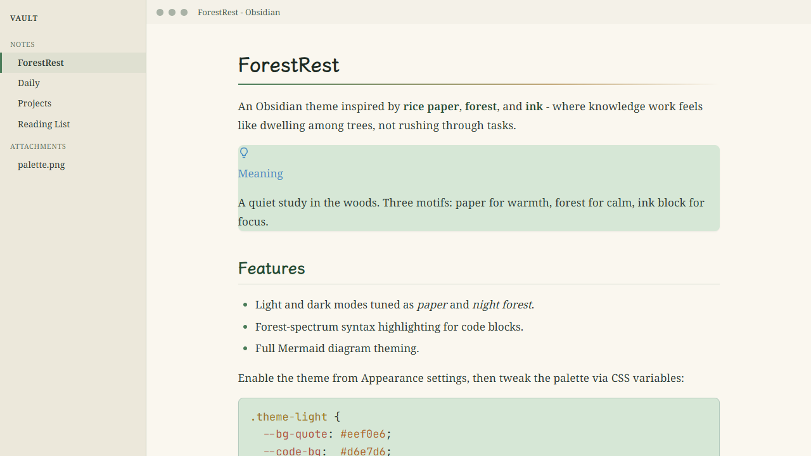
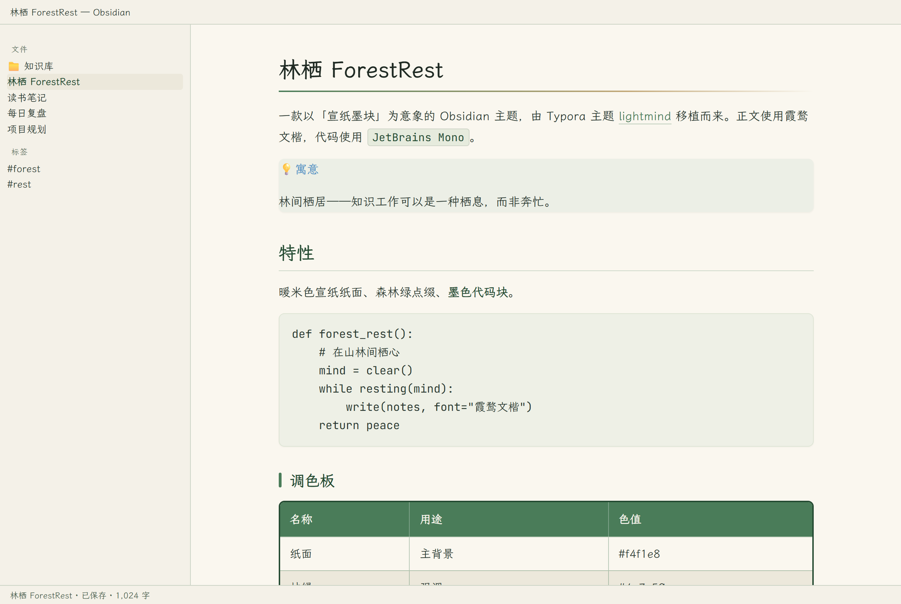
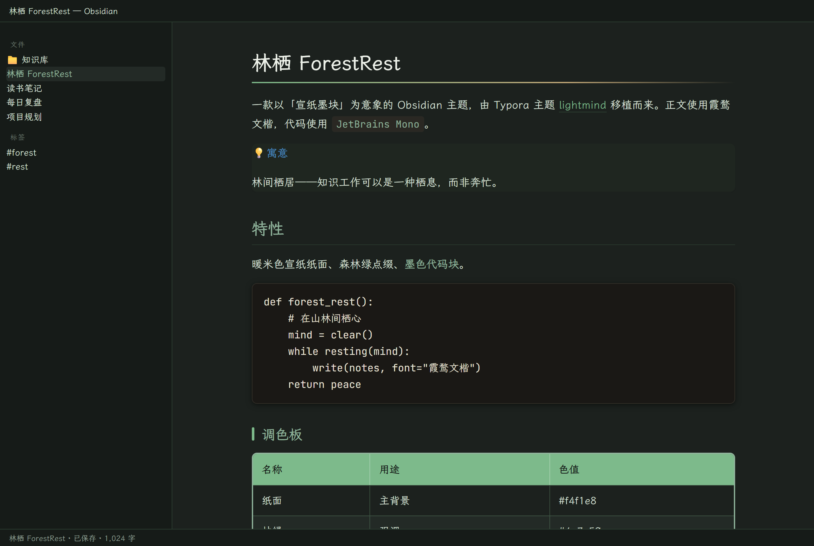

# ForestRest

> **Dwelling in the woods** —— an Obsidian theme built around the imagery of "ink on rice paper", ported from the Typora theme [lightmind](https://github.com/SunMoonTrain/LightMindTheme).

[](LICENSE)
[](manifest.json)
[](https://obsidian.md)
[](https://github.com/fengmz/ForestRest)
[](https://github.com/fengmz/ForestRest)

---

## Table of Contents

- [Design Philosophy](#design-philosophy)
- [Features](#features)
- [Palette](#palette)
- [Screenshots](#screenshots)
- [Installation](#installation)
- [Customization](#customization)
- [Acknowledgments](#acknowledgments)
- [License](#license)

---

## Design Philosophy

**ForestRest** takes its name from the ideal of retreating into the woods to rest the mind — the classical pursuit of scholars who withdrew to the mountains to read and think. The theme brings that experience of *"settling the mind among the hills and forests"* into your notes and code. Its deeper intent: **knowledge work can be a form of rest, not a relentless striving** — when thought lands on warm paper and is gently surrounded by the green of the forest, the mind naturally grows calm.

The whole design language revolves around three elements — **paper · forest · ink**:

| Element | Implementation | Meaning |
| --- | --- | --- |
| **Paper** | Warm beige surface `#f4f1e8` / `#faf7ef` | The warmth of traditional rice paper; a low-fatigue base for long reading |
| **Forest** | Forest green `#4a7c59`, deep green `#234a31`, new moss `#8fb39b` | Foliage peeking through the paper; green used sparingly as an accent |
| **Ink block** | Ink code background `#232220` | "A block of ink on rice paper" — code is thick ink brushed onto the page |
| **Warm gold / ochre** | `#c2a878` | Forest-filtered sunset light and autumn earth, warming the cool green |
| **Forest spectrum** | moss purple / autumn gold / new moss / ochre / stream cyan / warm clay | Every syntax color is drawn from something in the woods; reading code is like walking the forest |
| **Brush & ink** | Body in LXGW WenKai · code in JetBrains Mono | The warmth of a soft brush against the precision of hard ink |

Light is the primary mode (the paper metaphor); dark is derived as a "night forest" — a deep forest green-black (`#161b18`) that keeps the forest identity even after dark.

---

## Features

- **Warm beige rice-paper surface** for low-fatigue long reading.
- **Forest-green accents**, restrained and natural, never overwhelming.
- **Ink code blocks** — the core visual tension of "ink on rice paper" (宣纸上的墨块). In dark mode the block is ink-black (`#232220`); in light mode the same block uses a soft forest-green ground (`#d6e7d6`) so code stays gentle on the pale page.
- **Body in LXGW WenKai (霞鹜文楷), code in JetBrains Mono** — warmth versus precision.
- **Forest-spectrum syntax highlighting**: moss purple, autumn gold, new moss, ochre, stream cyan, warm clay.
- **Light-primary with a derived "night forest" dark mode**, both from one palette.
- **Full theming**: Callouts, tables, blockquotes, tags, math, and footnotes.
- **Pure local font fallback chain** — no external network dependencies.

---

## Palette

| Name | Usage | Hex | Preview |
| --- | --- | --- | --- |
| Page | Base background | `#f4f1e8` |  |
| Write | Editor / reading area | `#faf7ef` |  |
| Accent | Links / emphasis | `#4a7c59` |  |
| Deep | Headings / selection | `#234a31` |  |
| Soft | Secondary green | `#8fb39b` |  |
| Warm | Highlight / sunset | `#c2a878` |  |
| Ink | Code background | `#232220` |  |
| InkText | Code text | `#e7e2d4` |  |
| Night | Dark base background | `#161b18` |  |

---

## Screenshots



> The image above is a **concept preview** of ForestRest: warm beige paper, ink-black code blocks (ink on rice paper), forest-green foliage, and warm-gold autumn leaves — together expressing the "paper · forest · ink" motif.

### Actual interface

| Light (paper) | Dark (night forest) |
| --- | --- |
|  |  |

- **Light (paper)**: warm beige surface + forest-green headings + ink code blocks.
- **Dark (night forest)**: deep forest green-black ground + brightened forest-green accents.

---

## Installation

### Method 1: Community theme browser
1. Open Obsidian → **Settings → Appearance → Themes → Manage**.
2. Search for **ForestRest** and enable it.

### Method 2: Manual install
1. Download `manifest.json` and `theme.css` from this repository.
2. Place them in `<your vault>/.obsidian/themes/ForestRest/`.
3. Enable **ForestRest** under **Settings → Appearance**.

### Method 3: Via BRAT (development builds)
1. Install the [BRAT](https://github.com/TfTHacker/obsidian42-brat) plugin.
2. `Add a beta theme` → enter this repository URL.
3. Enable **ForestRest** under Appearance.

---

## Customization

The theme is driven by CSS variables. Override variables in `:root` or `.theme-light` / `.theme-dark` to fine-tune. For example, to shift the accent toward a deeper pine green:

```css
/* Append to your snippet or theme.css */
.theme-light {
  --accent: #2f6b43;
  --accent-deep: #173d24;
}
```

Commonly adjusted variables:

| Variable | Meaning |
| --- | --- |
| `--bg-page` / `--bg-write` | Paper / writing-area background |
| `--accent` / `--accent-deep` | Forest-green / deep-green accent |
| `--accent-warm` | Warm-gold accent |
| `--code-bg` / `--code-fg` | Ink-block background / text |
| `--font-body` / `--font-mono` | Body / code font stacks |
| `--cm-*` | Forest-spectrum syntax colors |

---

## Acknowledgments

- Ported from the design philosophy of the Typora theme [lightmind](https://github.com/SunMoonTrain/LightMindTheme) (clear / light mind → dwelling in the woods).
- Body font **LXGW WenKai (霞鹜文楷)** —— an open-source humanist CJK typeface.
- Code font **JetBrains Mono** —— JetBrains' open-source monospace typeface.
- Engineering, documentation, and preview images assisted by **WorkBuddy**.

---

## License

Distributed under the [MIT License](LICENSE). © 2026 fengmz.

---

## 中文

> **山林栖心** —— 一款以「宣纸墨块」为意象的 Obsidian 主题，由 Typora 主题 [lightmind](https://github.com/SunMoonTrain/LightMindTheme) 移植而来。

### 目录

- [寓意 · Design Philosophy](#寓意--design-philosophy)
- [特性 · Features](#特性--features)
- [调色板 · Palette](#调色板--palette)
- [预览 · Screenshots](#预览--screenshots)
- [安装 · Installation](#安装--installation)
- [自定义 · Customization](#自定义--customization)
- [致谢 · Acknowledgments](#致谢--acknowledgments)
- [许可证 · License](#许可证--license)

---

### 寓意 · Design Philosophy

**林栖**，取自「林间栖居」之意——古人退隐山林、栖心读书的生活理想。本主题试图把这种 *「在山林间安放身心」* 的体验，带入你的笔记与代码之中。它的深层寓意是：**知识工作可以是一种栖息，而非奔忙**——当思绪落于温暖的纸面、被森林的绿意轻轻环绕，心便自然沉静下来。

设计语言全部围绕「纸 · 林 · 墨」三元素展开：

| 意象 | 实现 | 寓意 |
| --- | --- | --- |
| **宣纸** | 暖米色纸面 `#f4f1e8` / `#faf7ef` | 传统书画之纸的温度，长时间阅读的低疲劳基底 |
| **森林** | 林绿 `#4a7c59`、深林 `#234a31`、新苔 `#8fb39b` | 枝叶从纸间透出的绿意，克制地点缀而非铺满 |
| **墨块** | 墨色代码块 `#232220` | 「宣纸上的墨块」——代码即落于纸上的浓墨 |
| **暖金/赭石** | `#c2a878` | 林间漏下的夕光与秋土，为冷绿注入暖意 |
| **山林色谱** | 苔紫 / 秋金 / 新生苔 / 赭石 / 溪青 / 暖陶 | 语法高亮的每种颜色都取自林中物，读码如行山 |
| **笔与墨** | 正文霞鹜文楷 · 代码 JetBrains Mono | 软笔书写的体温，对照硬朗精确的墨迹 |

浅色为主基调（纸的隐喻），深色则派生为「夜林」——`#161b18` 般的林 midnight 绿黑，让暗色模式依然栖于山林。

---

### 特性 · Features

- **暖米色宣纸纸面**，长时间阅读低疲劳。
- **森林绿点缀**，克制而自然，不喧宾夺主。
- **墨色代码块**——「宣纸上的墨块」核心视觉张力。深色模式下代码块为墨黑（`#232220`）；浅色模式下同一代码块改用柔和的林地淡绿底（`#d6e7d6`），在浅色纸面上依旧温润不刺眼。
- **正文霞鹜文楷（LXGW WenKai），代码 JetBrains Mono** 的体温/精确对照。
- **山林色谱语法高亮**：苔紫、秋金、新生苔、赭石、溪青、暖陶。
- **浅色为主、深色为「夜林」兜底**，两套调色板同源派生。
- **完整主题化**：标注（Callouts）、表格、引用块、标签、数学公式、脚注。
- **纯本地字体回退链**，不依赖任何外部网络资源。

---

### 调色板 · Palette

| 名称 | 用途 | 色值 | 预览 |
| --- | --- | --- | --- |
| 纸面 Page | 主背景 | `#f4f1e8` |  |
| 书写 Write | 编辑/阅读区 | `#faf7ef` |  |
| 林绿 Accent | 链接/强调 | `#4a7c59` |  |
| 深林 Deep | 标题/选中 | `#234a31` |  |
| 新苔 Soft | 次要绿 | `#8fb39b` |  |
| 暖金 Warm | 高亮/夕光 | `#c2a878` |  |
| 墨块 Ink | 代码底色 | `#232220` |  |
| 墨字 InkText | 代码文字 | `#e7e2d4` |  |
| 夜林 Night | 深色主背景 | `#161b18` |  |

---

### 预览 · Screenshots


> 上图为 **林栖 (ForestRest)** 的主题风格概念图：暖米色宣纸、墨色代码块（宣纸上的墨块）、森林绿枝叶与暖金秋叶，共同构成「纸 · 林 · 墨」的意象。

#### 实际界面

| 浅色（宣纸） | 深色（夜林） |
| --- | --- |
|  |  |

- **浅色（宣纸）**：暖米色纸面 + 森林绿标题 + 墨色代码块。
- **深色（夜林）**：林 midnight 绿黑底 + 提亮的林绿强调。

---

### 安装 · Installation

#### 方式一：社区主题浏览器
1. 打开 Obsidian → **设置 → 外观 → 主题 → 管理**。
2. 搜索 **林栖 / ForestRest** 并启用。

#### 方式二：手动安装
1. 下载本仓库的 `manifest.json` 与 `theme.css`。
2. 放入仓库目录：`<你的仓库>/.obsidian/themes/ForestRest/`。
3. 在 **设置 → 外观** 中选择 **ForestRest**。

#### 方式三：通过 BRAT（开发版）
1. 安装 [BRAT](https://github.com/TfTHacker/obsidian42-brat) 插件。
2. `Add a beta theme` → 填入本仓库地址。
3. 在外观设置中启用 **ForestRest**。

---

### 自定义 · Customization

主题以 CSS 变量驱动，覆盖 `:root` 或 `.theme-light` / `.theme-dark` 中的变量即可微调。例如，将强调色改为更深的松绿：

```css
/* 在你的 snippet 或 theme.css 末尾追加 */
.theme-light {
  --accent: #2f6b43;
  --accent-deep: #173d24;
}
```

常用可调变量：

| 变量 | 含义 |
| --- | --- |
| `--bg-page` / `--bg-write` | 纸面 / 书写区背景 |
| `--accent` / `--accent-deep` | 林绿 / 深林强调色 |
| `--accent-warm` | 暖金点缀 |
| `--code-bg` / `--code-fg` | 墨块底色 / 墨字 |
| `--font-body` / `--font-mono` | 正文 / 代码字体栈 |
| `--cm-*` | 语法高亮山林色谱 |

---

### 致谢 · Acknowledgments

- 移植自 Typora 主题 [lightmind](https://github.com/SunMoonTrain/LightMindTheme) 的设计理念（clear / light mind → 林栖）。
- 正文字体 **霞鹜文楷 (LXGW WenKai)** —— 开源人文中文字体。
- 代码字体 **JetBrains Mono** —— JetBrains 开源等宽字体。
- 主题的工程化、文档与预览图由 **WorkBuddy** 辅助完成。

---

### 许可证 · License

本项目基于 [MIT License](LICENSE) 开源。© 2026 fengmz.
